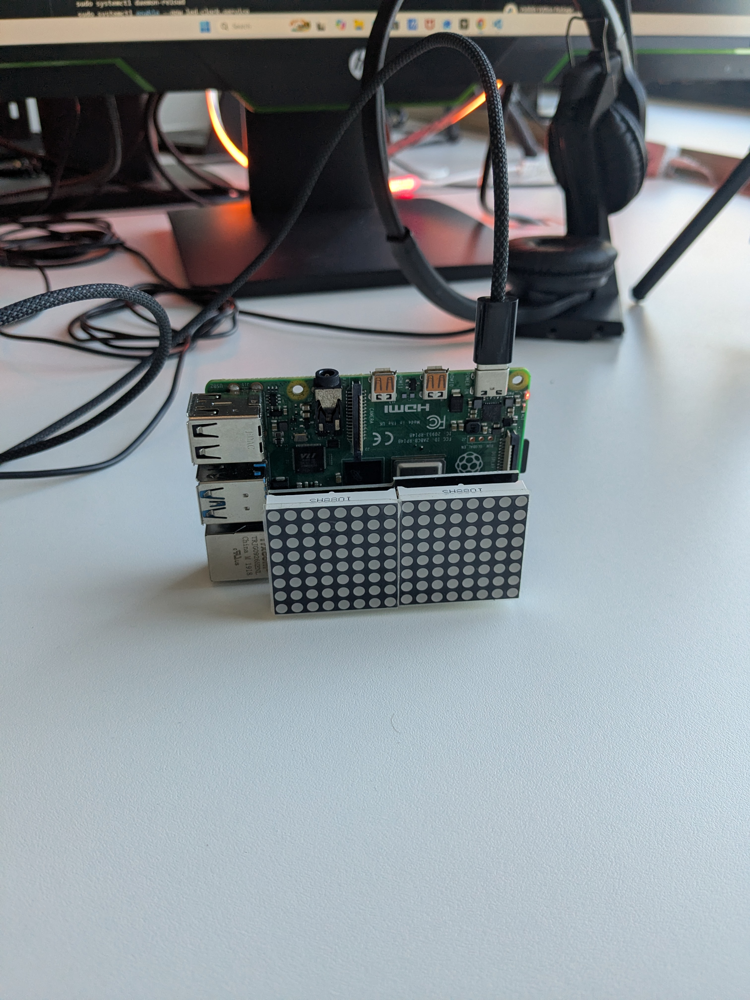
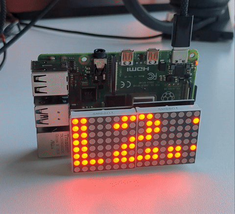

# Pi Time + Temp Display

A small Raspberry Pi desk clock: a Joy-IT 8x16 LED dot-matrix shield
(MAX7219, SPI) scrolls the current time, then the current temperature for
Paderborn, Germany (via [Open-Meteo](https://open-meteo.com/), no API key
needed), looping forever.

Runs as a systemd service so it comes back up automatically on every reboot.




([full-quality video](demo.mp4) also in this repo)

## Hardware

- Raspberry Pi (any model with a 40-pin GPIO header)
- [Joy-IT RB-LEDMatrix 8x16](https://joy-it.net/en/products/RB-LEDMatrix) —
  2 cascaded 8x8 MAX7219 blocks, plugs directly onto the GPIO header

## Setup

```bash
sudo raspi-config nonint do_spi 0   # enable SPI
python3 -m venv venv
./venv/bin/pip install luma.led_matrix spidev RPi.GPIO
```

Edit the latitude/longitude constants in `clock_weather.py` for your own
location.

## Run persistently (systemd)

```bash
sudo cp led-clock.service /etc/systemd/system/
sudo systemctl daemon-reload
sudo systemctl enable --now led-clock.service
```

Adjust the `User=` and path fields in `led-clock.service` to match your own
install location first.

## A gotcha worth knowing

Getting two cascaded MAX7219 blocks to render text correctly needs **both**
`block_orientation` and `blocks_arranged_in_reverse_order` set correctly —
the latter controls which physical chip gets which half of the display.
Symmetric test patterns (like a checkerboard) won't reveal a wrong
`blocks_arranged_in_reverse_order` setting, since swapping two checkerboard
halves still looks like a checkerboard. It only becomes obvious once you
render actual asymmetric content like scrolling digits.
